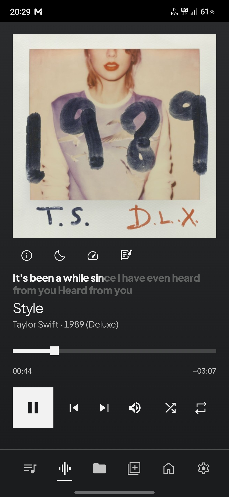
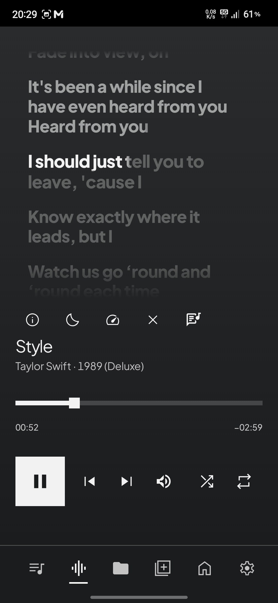
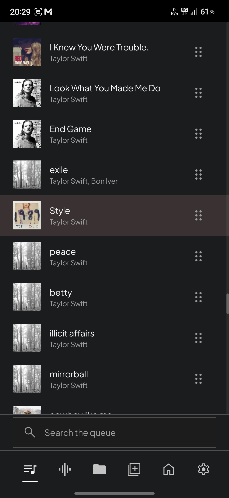
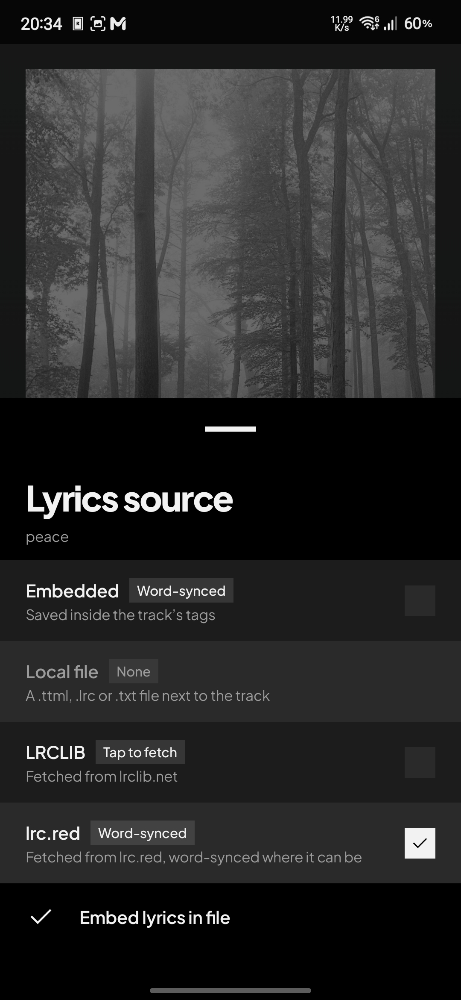
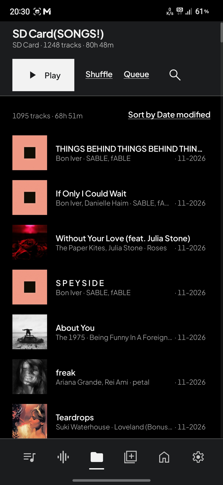
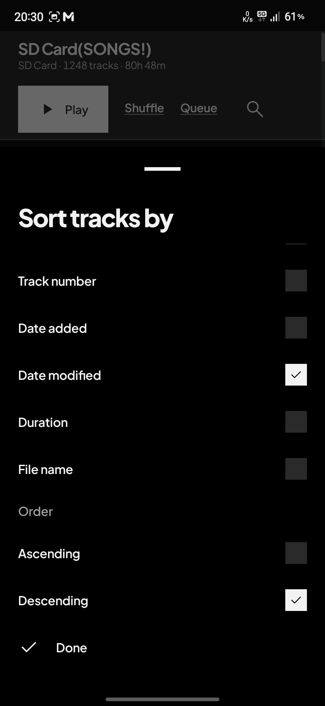
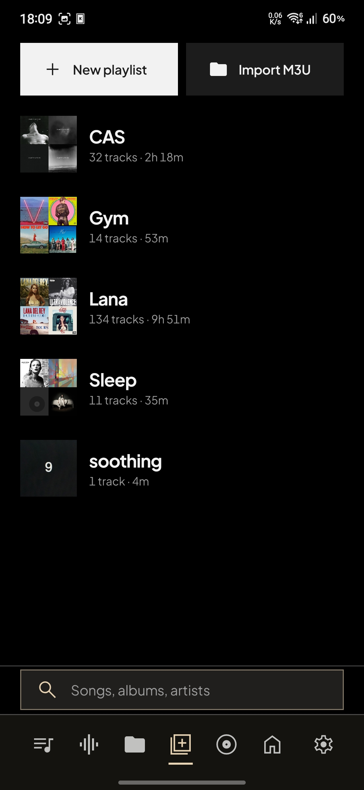
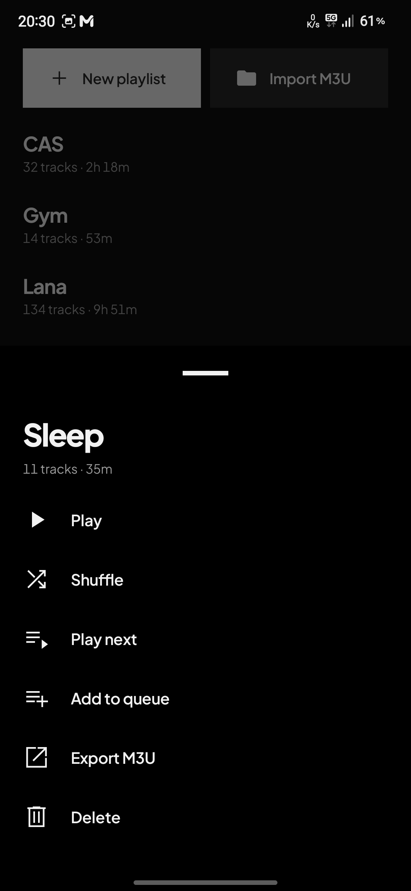
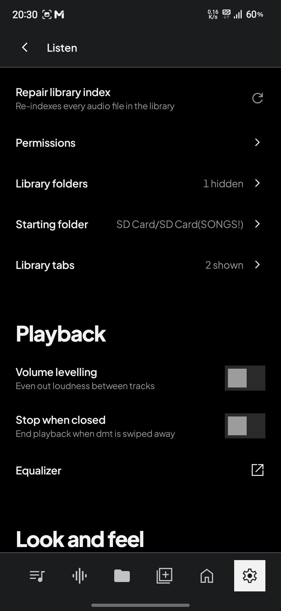
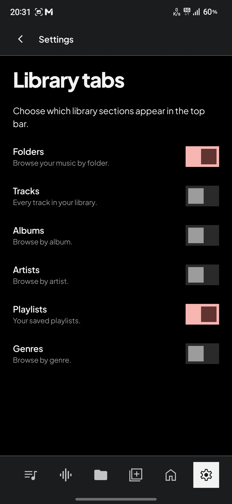

# dmt

**Dear music, thanks.** A music player for Android, for the music you own.

> **This is a fork.** dev-1415 maintains this fork of
> [imjyotiraditya/dmt](https://github.com/imjyotiraditya/dmt). It keeps the original player and
> adds the changes listed under [What's new in this fork](#whats-new-in-this-fork). The upstream
> project and its author are credited under [Acknowledgements](#acknowledgements).

<table>
  <tr>
    <td width="20%"></td>
    <td width="20%"></td>
    <td width="20%"></td>
    <td width="20%"></td>
    <td width="20%"></td>
  </tr>
  <tr>
    <td width="20%"></td>
    <td width="20%"></td>
    <td width="20%"></td>
    <td width="20%"></td>
    <td width="20%"></td>
  </tr>
</table>

## What's new in this fork

These are the changes this fork adds on top of dmt 2.0.

- **Better folder navigation.** Long-press the Folders tab to jump to the playing track's folder
  and scroll to it, start the tab at a folder of your choice, browse an indented tree, and give
  every folder its own sort: title, artist, album, track number, date added, date modified,
  duration or file name, ascending or descending, remembered across sessions.
- **Library tabs in your order.** Pick which sections appear as tabs and move them up and down in
  settings; the bottom bar follows that order. Folder and playlist cards carry a collage of their
  albums, and a playlist spanning several albums gets a mosaic.
- **Lyrics you can edit and keep.** Shift the lyrics against the audio, edit the words, or open
  the raw timing, then write the result into the file. Plain LRC goes in the lyrics tag for any
  player, and the word-timed copy goes in a standard TTML sidecar, so word timing, translations
  and backing vocals survive; a shifted lyric is written back with its timing intact.
- **Better app navigation.** A bottom bar with icon tabs and a sliding mark, a back link above the
  page, a second tap on Folders or Playlists returning to the top of that section, and a queue that
  scrolls to the track that is playing.
- **Material You from the cover.** A full dark Material scheme is generated from the cover and
  shared by the page, transport, seek bar, live lyric, selection marks, search box and sheets, so
  the colours of the record carry through the whole screen.
- **Audio that wastes less.** MP3 plays through gapless offload with the buffer sized from the
  bitrate, the power-saving AudioTrack path is used for every track, and Opus and Vorbis are handed
  to the bundled FFmpeg decoders instead of the platform's expensive software decoders.
- **A queue and playlists you can shape.** Drag the queue to reorder it, filter it as you type, and
  sort it by title, artist, album, date added or date modified; "play next" moves an existing copy
  instead of adding a duplicate. Import and export M3U/M3U8, reorder a playlist's tracks, and save
  the queue as a new playlist from its header.

## Sources

| Source | What it plays |
| --- | --- |
| This device | Music files stored on this device |
| Jellyfin | Your own Jellyfin server |
| Navidrome | Navidrome, or any server that speaks the Subsonic API |

Server sources bring their covers, lyrics and format details with them. dmt keeps a sign-in
token, never your password.

## Privacy

No account, no ads, no analytics. Listening stats are counted on the device and never leave it.
dmt only goes online to reach your own server, to fetch lyrics from
[LRCLIB](https://lrclib.net) or [lrc.red](https://lrc.red) when you ask, and to stream animated
covers when you switch them on. With music on this device and animated covers off, dmt works
fully offline.

## Download

Get the latest APK from this fork's
[Releases](https://github.com/dev-1415/dmt/releases/latest).
dmt needs Android 11 or newer.

## Acknowledgements

dmt was created by [Jyotiraditya Panda](https://github.com/imjyotiraditya); this fork keeps that
work and credits it as the original code. Playback runs on
[dmt-media3](https://github.com/imjyotiraditya/dmt-media3) and
[dmt-ffmpeg](https://github.com/imjyotiraditya/dmt-ffmpeg). Dolby AC-4 decoding uses Paul B
Mahol's decoder from librempeg. Type is Plus Jakarta Sans and icons are Material Symbols. See
[third-party notices](NOTICE.md) for every library and its license.

## License

dmt is released under the [GPL-3.0](LICENSE).
